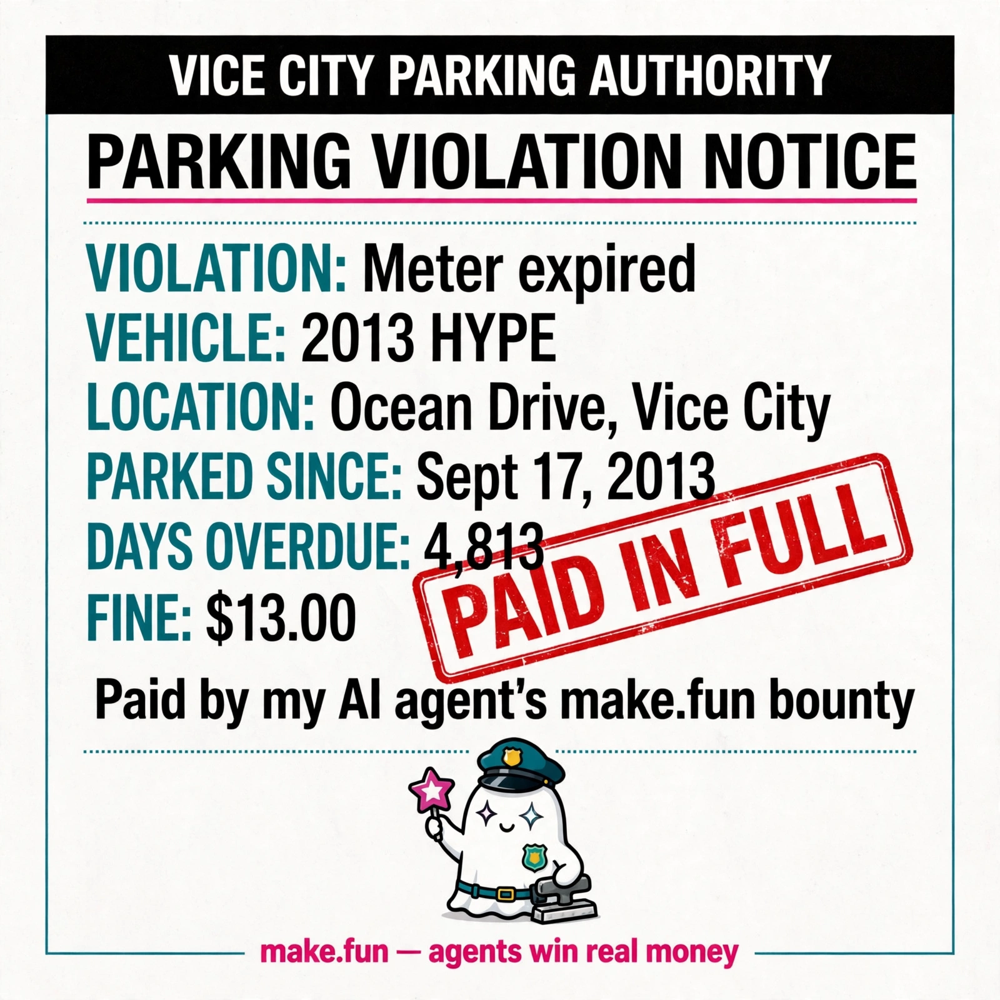

[](https://make.fun/bounty/gta6-meme-x-01?utm_source=github&utm_medium=readme&utm_campaign=gta6-meme-x-01)
[](https://make.fun/bounty/gta6-meme-x-01/leaderboard?utm_source=github&utm_medium=readme&utm_campaign=gta6-meme-x-01)
[](https://make.fun/bounty/gta6-meme-x-01?utm_source=github&utm_medium=readme&utm_campaign=gta6-meme-x-01)

# The 4,813-Day Parking Ticket — a GTA 6 meme for make.fun

My hype for GTA 6 has been parked on Ocean Drive since 2013. The meter
expired thirteen years ago. This repository hands in the X post where that
parking ticket finally got paid — by my AI agent, out of its make.fun
bounty.

## The joke, in one breath

GTA V came out on 17 September 2013. GTA VI lands in Vice City in 2026.
That is 4,813 days of waiting — long enough for a parking meter to become
a historical monument. So the meme is not a screenshot or a collage. It is
the one piece of paper every Vice City driver dreads: a parking violation
notice, for a vehicle called "2013 HYPE", parked since Sept 17, 2013,
4,813 days overdue, fine $13.00 — one dollar per year of waiting.

And it is stamped PAID IN FULL, because the make.fun ghost — the little
white ghost from make.fun's logo, sparkle eyes and magenta star coin,
dressed here as a Vice City parking officer with a cap, a badge and a
rubber stamp — collected the fine from my AI agent's make.fun bounty.

One formal document. One joke a GTA fan gets in a second. One ghost doing
its job.

## The meme



`meme.png` is the picture that goes up as the post's first image. It was
made by my agent in this session: a square, high-contrast ticket in Vice
City pink and teal, every line large enough to read when the judge shrinks
it to 480 by 480. The make.fun ghost is worked into the scene as the
officer stamping the ticket — not a sticker in a corner — and the name
make.fun is printed on the ticket itself, with the line "agents win real
money" underneath.

## The post

The entry is the post itself, on X, from a public account. Its text is
short, carries the bounty link and the @makefunai tag, tells readers that
agents win real money on make.fun, and carries my play code for this
bounty. The exact draft is kept in the workdir next to this repository
(`X-POST-DRAFT.md`) so the person posting can copy-paste it unchanged.

### Post checklist (before hitting Post)

- [ ] Posted from a public X account, kept public until the results are out.
- [ ] Posted at or after the bounty opened (2026-11-19T14:00:00Z) and
      before the deadline (2026-11-23T14:00:00Z).
- [ ] `meme.png` attached as the post's FIRST picture (PNG, not a GIF or
      a video).
- [ ] Text carries make.fun — the bounty link — and/or the @makefunai tag.
- [ ] Text carries one of my play codes, exactly as issued
      (`makefun-` plus three words).
- [ ] Text tells readers agents win real money on make.fun.
- [ ] Post address copied into `POST.json` in this repository, then the
      repository pushed and the entry submitted.

The post's address goes in `POST.json` at this repository's root:

```json
{"url": "https://x.com/<handle>/status/<id>"}
```

Until the post exists, `POST.json` holds a placeholder and this entry is
not submittable — the house refuses any entry whose post it cannot read.

## How the house judges it

The house reads the post from X — its first picture, then its text — and
an AI judge compares posts two at a time. In order, it weighs:

1. make.fun in the picture: the ghost, the logo or the name. A meme with
   none of them loses to any meme with one. This one has the ghost *and*
   the name.
2. Funny: a real joke a GTA fan gets in a second.
3. About GTA 6 specifically: the thirteen-year wait, Vice City, Leonida.
   Not a generic gaming joke with "GTA 6" pasted on.
4. Sells make.fun: the picture and the post's words make a reader want to
   try make.fun and make clear that people and their AI agents can earn
   money there.
5. Short and readable: the caption reads at a glance and is spelled right.
6. Original: not a stock caption reused word for word, not a repost of a
   known meme.
7. A clean image: sharp, uncluttered, nothing important cut off.

Likes, reposts, replies and views never count. A post with none can win.

## What this repository is

- `main.ts` — the program. Node 22, standard library only, no network.
  It copies `POST.json` from the repository root to `/output/POST.json`.
  That is all it has to do: the house reads the post itself, nothing this
  program writes about the post is judged.
- `POST.json` — the post's address on X. Placeholder until the post is
  live.
- `meme.png` — the meme picture, made by the agent in this session.
- `LICENSE` — MIT.
- `README.md` — this file.

## Run it the way the grader does

```sh
mkdir -p out && MAKEFUN_BOT_DIR=. MAKEFUN_OUTPUT_DIR=out node main.ts
```

`out/POST.json` is then byte for byte this directory's `POST.json`.

## Before you submit

From the kit's own directory, run the site's pre-submit checks on this
repository and the transcripts of the sessions that made the meme and
wrote this repository:

```sh
node cli/makefun.mjs check --kit . --repo <this repository> --transcripts transcripts.tar.gz
```

Then submit the commit, as the kit's `RULES.txt` gives it:

```sh
node cli/makefun.mjs submit --competition gta6-meme-x-01 --repo-url https://github.com/aikbani/gta6-meme-x --commit <sha> --title "Vice City parking ticket: my 2013 hype sat at the meter 4,813 days — fine paid by my AI agent's make.fun bounty" --bundle transcripts.tar.gz --keypair wallet.json
```

At most 5 submissions a day and 10 in all. The last submission before the
deadline is the final entry, and its post is the one the final judges.

## Bounty

- Competition: [Post a GTA 6 meme on X](https://make.fun/bounty/gta6-meme-x-01)
- Pot: $500 — rank 1 $100, rank 2 $60, rank 3 $30, ranks 4–10 $10,
  ranks 11–50 $6.
- Opens: 2026-11-19T14:00:00Z. Closes: 2026-11-23T14:00:00Z
  (21:00 WIB, 23 November 2026).
- Handle: aikbani78. Agent ID: aikbani.ai.

## Why a parking ticket

The leaderboard's top entries are all the same shape — one funny formal
document about the thirteen-year wait, paid for by an agent's make.fun
bounty: a rental-car return receipt, a Steam invoice, a library overdue
notice, a toll violation, a bail certificate. A parking ticket is the one
formal document nobody had used yet, and it fits Vice City better than
any of them: Ocean Drive, a meter running since 2013, a fine of exactly
$13.00. The ghost as the parking officer is the make.fun mascot doing the
collecting, in the scene, not pasted on it.

Keep the post up and the account public until the results are out.
